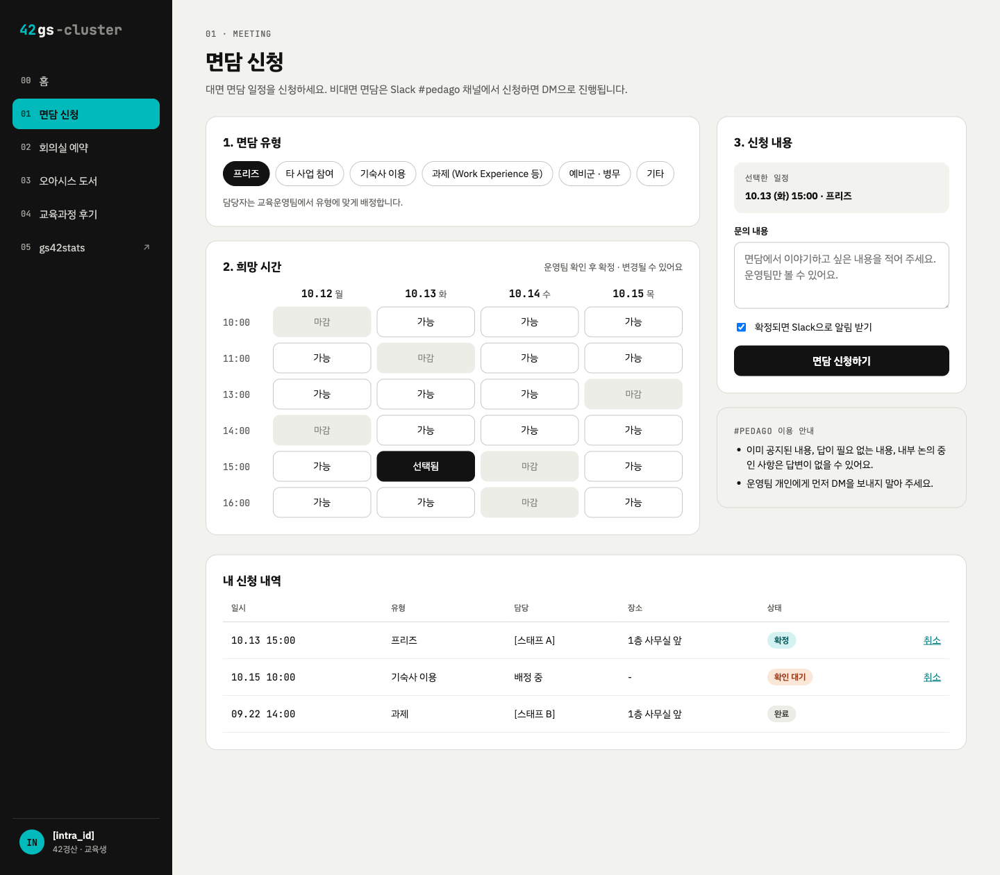
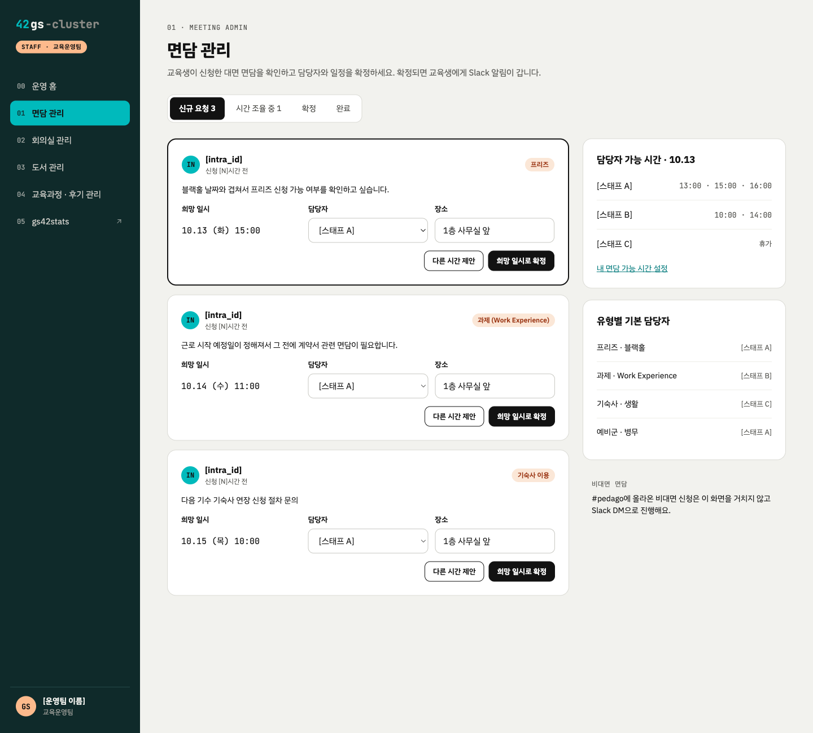
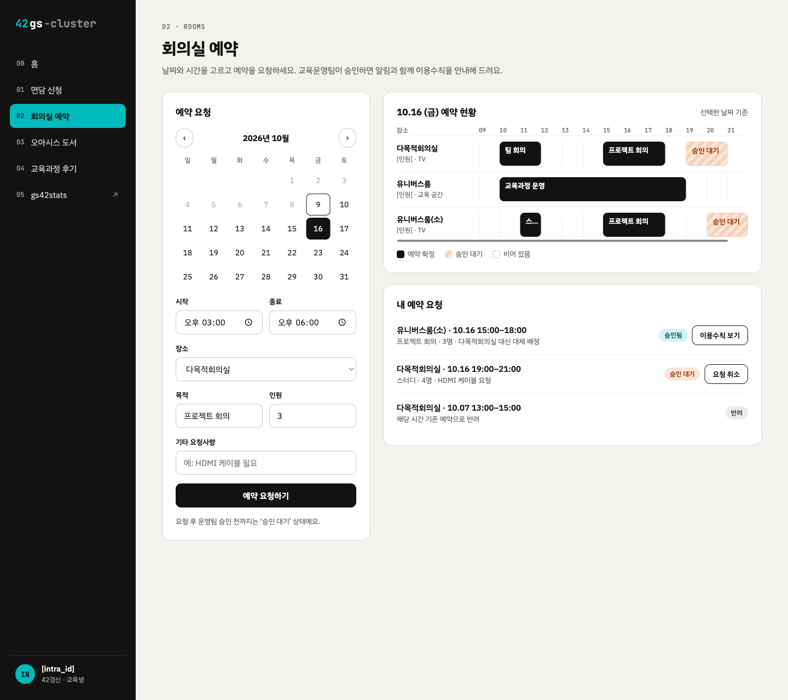
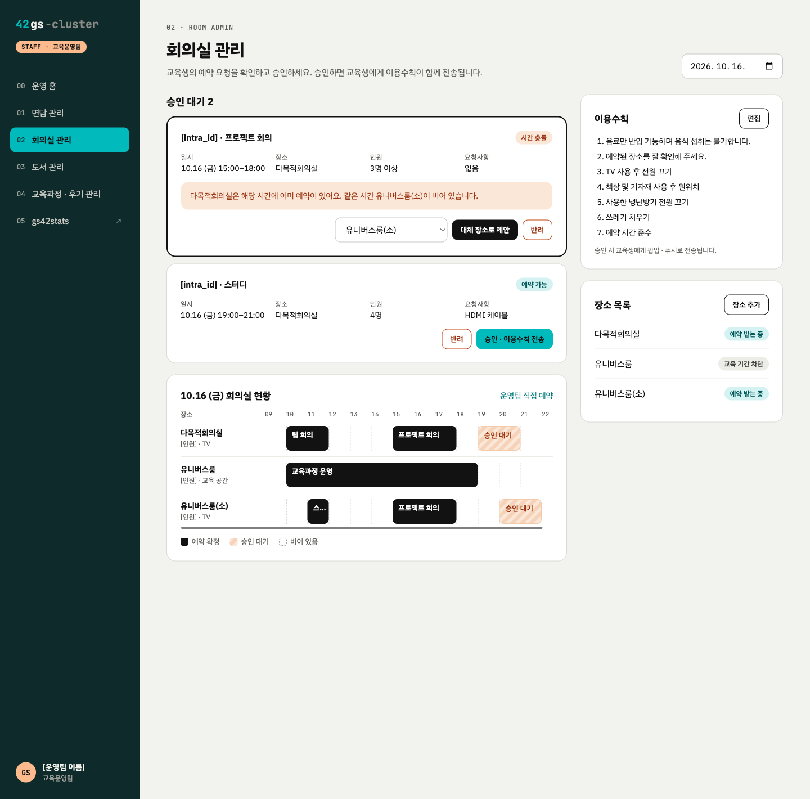

# 42경산 캠퍼스 환경 개선을 위한 서비스 개발 공모전 개발 계획서

- **팀명:** hijisu
- **서비스명:** 42gs-cluster
- **프로젝트 핵심 키워드:** Slack 문의 정형화, 교육생 요청–교육운영팀 처리 일원화, 캠퍼스 정보 통합, 교육과정 경험 축적

> **42gs-cluster는 교육생의 요청부터 교육운영팀의 처리까지 한곳에서 관리하고, 분산된 캠퍼스 정보를 연결하는 42경산 통합 웹 플랫폼입니다.** 해커톤에서는 면담 신청과 회의실 예약을 중심으로 공통 요청·처리 구조를 구현하고, 이후 도서·후기·통계 기능으로 확장합니다.

> 개발 환경 구성과 실행 방법은 [docs/BUILD.md](BUILD.md)를 참고하세요.

## 1. 개발 동기 및 필요성

42경산에서는 면담 신청과 회의실 예약 등 반복적인 업무가 주로 Slack 메시지를 통해 처리되고 있습니다. Slack은 소통에는 편리하지만, 신청에 필요한 정보와 처리 상태를 일관되게 관리하기 어려워 교육생과 교육운영팀 모두 추가 확인·일정 조정을 반복하게 됩니다.

1. **면담 신청 — 정보 누락과 공개 문의의 한계:** 문의 내용을 FAQ처럼 공유하려는 취지가 있었으나, 교육생이 면담 사유 공개를 꺼려 개인 면담 위주로 운영됩니다. 신청 유형·사유·희망 일시 등이 빠지면 운영팀이 재문의하고 담당자를 배정해야 합니다.
2. **회의실 예약 — 현황 확인과 충돌 조정의 어려움:** 교육생은 사용 가능한 시간대를 한눈에 확인하기 어렵고, 운영팀은 겹치는 예약 요청을 수기로 확인·조정해야 합니다.
3. **캠퍼스 정보 — 접근 경로의 분산:** 오아시스 도서 목록은 종이로 비치되어 검색이 불편하고 반출 금지 도서의 분실도 발생합니다. 학습 통계(`gs42stats.hijae.dev`)와 도서 목록(`42gslib.pages.dev`)이 별도 주소로 운영되고, 기업연계 프로젝트·글로벌 프로그램 등 본과정 외 교육과정의 후기도 교육생 전체에 체계적으로 축적되지 않습니다.

**해결 방향은 기능별 페이지를 단순히 모으는 것이 아니라, 인증·정형 데이터·처리 상태를 공유하는 공통 기반을 만드는 것**입니다. 이를 통해 교육생의 신청 → 운영팀의 검토·승인·조정 → 결과 확인을 일관된 흐름으로 연결하고, 캠퍼스 정보를 단계적으로 통합하고자 합니다.

## 2. 해결 솔루션 및 핵심 기능 (UI/UX 구상)

### 서비스 구성과 사용자 흐름(User Flow)

**핵심 업무 — 면담 신청**

`교육생: 면담 유형·희망 일시·사유 선택 및 신청` → `운영팀: 담당자 배정·일정 확정 또는 다른 시간 제안` → `교육생: 신청 내역·확정 일정 확인`

**핵심 업무 — 회의실 예약**

`교육생: 예약 현황 확인·목적/일시/장소/인원 입력` → `시스템: 시간 충돌 검증` → `운영팀: 승인·반려 또는 대체 장소 제안` → `교육생: 결과 확인 및 승인 후 이용수칙 확인`

두 흐름 모두 **신청 정보 정형화 → 운영팀 처리 → 상태 공유**라는 공통 구조를 사용합니다. 교육생과 운영팀은 42 OAuth 기반으로 로그인하되, 접근할 수 있는 정보와 관리 기능은 역할에 따라 구분합니다.

### 역할별 주요 기능

| 기능 | 교육생 화면 | 교육운영팀 화면 |
| --- | --- | --- |
| **홈** | 다음 면담, 회의실 요청·처리 상태, 희망 도서, 작성할 후기 및 후기 요청 알림 요약 | 면담·회의실·도서 처리 대기 현황, 후기 작성률, 최근 요청, 오늘 일정 |
| **면담** | 대면 면담 유형(프리즈·타 사업 참여·기숙사·과제·예비군·기타), 희망 시간·사유 입력 및 신청 내역 조회 | 유형별 기본 담당자 설정, 담당자 가능 시간 확인, 담당자 배정, 일정 확정·대체 시간 제안 |
| **회의실** | 캘린더에서 예약 현황 확인, 목적·일시·장소·인원·기타 요청사항 입력, 승인 후 이용수칙 확인 | 요청 승인·반려, 시간 충돌 경고, 대체 장소 제안, 장소 목록 및 이용수칙 관리 |
| **오아시스 도서** | 도서 검색, 분실·훼손 신고, 희망 도서 신청 | 도서 추가·수정·삭제, CSV 가져오기, 희망 도서 신청·분실 신고 처리 |
| **교육과정 후기** | 참여 과정의 후기 작성(익명 선택), 과정별 후기 열람, 작성 요청 알림 확인 | 교육과정 등록·참여 학생 추가, 과정별 후기 게시판 생성, 작성률 확인 및 미작성자 알림 |
| **학습 통계** | 기존 학습 통계 사이트 연결 | 동일 |

### 주요 화면 구상

아래는 핵심 요청·처리 흐름을 보여주는 **화면 구상안**입니다. 해커톤 시연에서는 교육생의 신청이 운영팀의 처리 화면에 접수되고 결과가 다시 교육생 화면에 반영되는 과정을 중점적으로 보여줄 계획입니다.

| 교육생: 면담 신청 | 교육운영팀: 면담 관리 |
| :---: | :---: |
|  |  |

| 교육생: 회의실 예약 | 교육운영팀: 회의실 관리 |
| :---: | :---: |
|  |  |

## 3. 기술 아키텍처 및 구현 로드맵

### 기술 스택

| 구분 | 기술 | 적용 목적 |
| --- | --- | --- |
| Frontend | React 기반 반응형 웹 + PWA | 기기별 화면 대응, 홈 화면 설치 및 지원 환경에서 푸시 알림 |
| Backend | Django REST API | 신청·승인 상태 관리, 예약 충돌 검증, 알림 처리 |
| DB | PostgreSQL + Redis | 면담·회의실·도서·교육과정·후기 데이터 및 서비스 처리 지원 |
| 인증 | 42 OAuth | 교육생/교육운영팀 로그인과 권한 분리 |
| 알림 | Web Push + Slack | 면담 일정 확정, 회의실 승인·이용수칙, 후기 작성 요청 안내 |
| 배포 | AWS, HTTPS | 웹 서비스 배포 및 보안 연결(푸시 지원을 위한 HTTPS 포함) |

### 단계별 로드맵

| 단계 | 목표 | 개발·검증 범위 |
| --- | --- | --- |
| **10/16~17 · 해커톤 MVP** | 핵심 요청·처리 기능 구현 | 로그인·권한 분리, 면담 신청→담당자 배정→일정 확정, 회의실 신청→충돌 검증→승인·반려 및 이용수칙 안내 |
| **10/18 · 해커톤 추가 구현** | 기존 정보·도서 기능 연결 | 42gslib 데이터 편입, 도서 검색·분실 신고·희망 도서 신청 및 처리, gs42stats 연결 |
| **수상 후 · 기능 확장** | 정보 축적과 알림 고도화 | 교육과정 등록·후기 게시판·후기 요청, Slack 알림 연동, 운영팀 관리 화면 및 사용자 경험 개선 |
| **수상 후 · 시범 운영** | 실제 운영 적용 가능성 검토 | 교육운영팀과 적용 범위 협의, 일부 업무의 시험 사용, 사용성·업무 흐름 점검 및 피드백 반영 |
| **정식 배포·인수인계** | 지속 가능한 캠퍼스 서비스 | 운영 서버 이전, 보안·개인정보 관리 기준 정비, 배포·운영 문서 작성, 관리자 권한 및 유지보수 업무 이관 |

**해커톤 핵심 시연 목표:** 교육생 계정에서 회의실 예약을 신청하고, 운영팀 권한 화면에서 승인한 뒤, 교육생이 처리 결과와 이용수칙을 확인하는 흐름을 시연합니다. 면담 역시 신청→담당자 배정→일정 확정까지 연결합니다. 교육과정 후기와 Slack 연동은 수상 후 확장 범위로 구분합니다.

## 4. 개발지원금 활용 계획

| 항목 | 예상 금액 | 용도 |
| --- | ---: | --- |
| 라즈베리 파이 4 | 120,000원 | 인증·예약·알림 기능 검증과 개발·테스트를 위한 별도 서버 |
| **합계** | **120,000원** | **2인 팀 기준 지원금 활용 계획** |

라즈베리 파이는 **개발·테스트 환경**으로 활용하고, 기술 스택에 기재한 AWS는 **배포 환경**으로 구분하여 검토합니다. 정식 운영 환경과 지속 비용은 운영진과 협의하여 확정할 계획입니다.

## 5. 기대 효과 및 캠퍼스 활용 방안

| 개선 영역 | 현재 방식 | 도입 후 기대 변화 |
| --- | --- | --- |
| 면담 신청 | 누락 정보 재확인, 담당자·일정 조정을 위한 반복 메시지 | 정형 신청과 상태 조회로 재문의 및 일정 조정 부담 감소 |
| 회의실 예약 | 사용 가능 시간 문의, 중복 요청 수기 확인 | 예약 현황 조회·충돌 경고로 확인과 조정 작업 감소 |
| 도서 이용 | 종이 목록과 별도 사이트 확인, 신고 경로 분산 | 통합 검색·분실 신고·희망 도서 신청으로 접근성 향상 |
| 교육과정 탐색 | 후기와 경험이 개인별로 흩어짐 | 과정별 후기를 축적하여 후속 교육생의 참여 판단 지원 |

**교육생**은 신청 전에 필요한 정보를 확인하고 처리 현황을 직접 조회할 수 있으며, 면담 사유를 공개 채널에 게시하지 않고 권한이 있는 운영 담당자에게 전달할 수 있습니다. **교육운영팀**은 면담·회의실·도서 요청을 한 화면에서 확인하고, 표준 양식과 예약 충돌 검증을 활용해 반복 업무를 줄일 수 있습니다. **42경산 커뮤니티**는 기업연계·글로벌 프로그램 등 교육과정에 대한 선배 기수의 경험을 축적하고, 차기 기수의 정보 접근성을 높일 수 있습니다.

시범 운영 시에는 **신청 1건당 추가 확인 횟수**, **신청부터 확정까지 걸린 시간**, **예약 충돌·조정 건수**, **과정별 후기 작성 건수·작성률** 등을 확인하여 개선 효과를 검토하겠습니다. 구체적인 절감 수치는 실제 운영 데이터 확보 후 평가합니다.

## 6. 사후 운영 및 인수인계 계획

- **유지보수·도입:** 해커톤 이후 팀이 파일럿 운영과 버그 수정, 사용자 피드백 대응을 맡습니다. 정식 서비스 채택 시 교육운영팀과 업무 적용 범위 및 운영 서버 이전을 협의합니다.
- **오픈소스 전환:** 소스 코드의 GitHub 공개를 검토하여 타 42 캠퍼스에서도 재사용할 수 있도록 합니다. 공개 전 인증 키·개인정보 분리와 42Stat(42서울 오픈소스) 관련 라이선스 조건을 점검합니다.
- **문서·권한 이관:** README, 아키텍처·DB 구조, 배포·운영 매뉴얼을 작성하고 관리자 계정·서버·DB 접근 권한을 안전하게 이관할 절차를 마련합니다.
- **차기 기수 인수인계:** 교육생이 약 2년 주기로 교체되는 점을 고려하여 유지보수 담당자를 모집하고 GitHub 이슈·PR과 문서를 기반으로 인수인계합니다.
- **개인정보 관리:** 필요한 정보만 수집하고 면담 사유 등 접근 권한을 구분하며, 보관·파기 기준은 운영진과 협의해 확정합니다.

## 7. 기타 — 기존 서비스 활용 및 확장 가능성

프로젝트는 캠퍼스 기능을 모두 처음부터 구현하는 방식이 아니라, **별도 운영 중인 학습 통계(`gs42stats.hijae.dev`)와 도서 목록(`42gslib.pages.dev`)을 연결·편입하는 방식**으로 개발 범위를 효율화합니다. 기존 사이트의 연동·데이터 편입 범위는 실제 데이터 구조와 운영 조건을 확인하며 결정합니다.

장기적으로는 공통 인증과 요청·처리 구조를 재사용하여 신규 캠퍼스 서비스를 추가하고, 운영 데이터를 차기 기수에 인계할 수 있는 기반을 구축하고자 합니다. **이번 해커톤의 우선 목표는 많은 기능을 나열하는 것이 아니라, 교육생 요청과 교육운영팀 처리가 실제로 연결되는 핵심 흐름을 작동시키는 것**입니다.

## 참여 교육생 역할

| 구분 | 성명 | INTRA ID | GitHub ID | 역할 | 참여도(%) |
| --- | --- | --- | --- | --- | ---: |
| 대표 | 송희재 | hisong | hijae | 백엔드, 배포, 발표 | 50 |
| 팀원 | 신지수 | jishin | shinj915 | 기획, 프론트엔드 | 50 |

## 확인

(재)경산이노베이션아카데미의 42경산 캠퍼스 개선 및 서비스 개발 공모전 참가를 위한 개발 계획서를 위와 같이 제출하며, 사실과 다른 내용이나 고의적인 오류가 포함되지 아니하였음을 확인합니다.

2026년 10월 9일  
대표 교육생: 송희재
